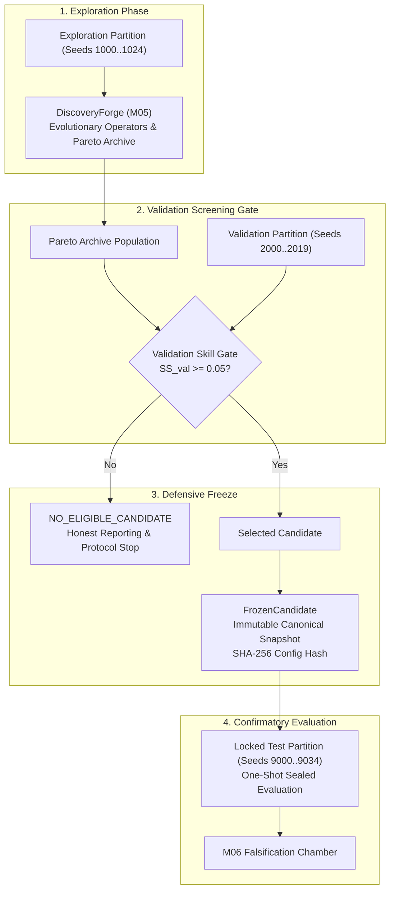

# SENSEFORGE: Candidate Selection, Freezing, and Lifecycle Architecture

**Project:** SENSEFORGE  
**Classification:** Experimental Computational Science / Artificial Intelligence Research  
**Version:** `0.3.1-alpha`  
**Status:** SPECIFICATION & ARCHITECTURAL REFERENCE  

---

## 1. The Candidate Lifecycle

To eliminate p-hacking, cherry-picking, and in-sample selection leakage, candidate discovery instruments undergo a strictly unidirectional lifecycle governed by [`CandidateLifecycleManager`](file:///c:/akshar/senseforge/discovery/selection.py):

---

## 2. Selection Methodology & The Qualification Gate

### 2.1 Pure Evolutionary Generation
All evolutionary operations (AST crossover, probe action mutations, NSGA-II non-dominated sorting) occur exclusively on the **Exploration Partition** ($\mathcal{S}_{\text{exp}} = [1000..1024]$).
Neither validation seeds nor locked confirmatory seeds are ever observed during evolutionary generations.

### 2.2 Validation Screening
Every candidate in the final Pareto archive is evaluated on the independent **Validation Partition** ($\mathcal{S}_{\text{val}} = [2000..2019]$):
1. A downstream L2 ridge estimator is fit on exploration features and targets.
2. The candidate estimates the common scientific target across validation seeds.
3. Validation skill over passive observation is computed:
   $$SS_{\text{val}} = 1 - \frac{\text{MSE}_{\text{candidate}}(\mathcal{S}_{\text{val}})}{\text{MSE}_{\text{passive}}(\mathcal{S}_{\text{val}})}$$

### 2.3 The Honest Qualification Gate
- If $\max_{c \in \text{Archive}} SS_{\text{val}}(c) < 0.05$:
  The lifecycle manager outputs:
  $$\mathbf{Status} = \mathbf{NO\_ELIGIBLE\_CANDIDATE}$$
  The protocol immediately logs the negative outcome without substituting random genomes.
- If one or more candidates pass the threshold, the highest-ranking candidate is selected.

---

## 3. Defensive Immutability: FrozenCandidate

Once selected, the candidate is sealed inside [`FrozenCandidate`](file:///c:/akshar/senseforge/falsification/manifest.py):

### 3.1 Canonical JSON Serialization & Hashing
The candidate AST $\Phi$, probe schedule $\Pi$, and downstream estimator weights $\mathbf{w}$ are serialized to canonical JSON (sorted keys, compact separators):
$$S = \text{CanonicalJSON}(\Psi)$$
$$\mathcal{H}(\Psi) = \text{SHA256}(S) \in \{0, 1\}^{256}$$

### 3.2 Defensive Object Decoupling
To prevent memory mutation attacks:
- The internal state is stored exclusively as string $S$.
- Attribute mutations on `FrozenCandidate` raise [`CandidateFrozenError`](file:///c:/akshar/senseforge/falsification/manifest.py).
- External calls to `.candidate` return a freshly deserialized, cloned instance. Mutating the clone has zero effect on $S$ or $\mathcal{H}(\Psi)$.
- `verify_integrity()` is invoked prior to every evaluation, recomputing the SHA-256 digest and asserting exact equality.

---

## 4. Persistent Partition Locking

To prevent candidate retuning across process restarts:
1. `PartitionManager` persists candidate access records to disk (`.partition_lock.json`).
2. If `candidate_id` requests access to `LOCKED_TEST` seeds:
   - On first access: the pair `(candidate_id, config_hash)` is recorded and saved to disk.
   - On subsequent access: if the supplied `config_hash` differs from the persisted record, execution is immediately aborted with [`PartitionSealedViolation`](file:///c:/akshar/senseforge/falsification/partition.py).
