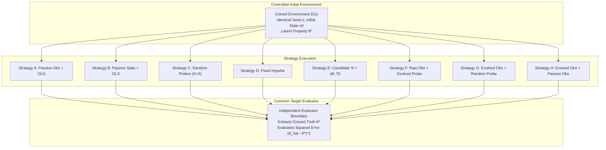

# SENSEFORGE: Common Target Evaluation Specification

**Project:** SENSEFORGE  
**Classification:** Experimental Computational Science / Artificial Intelligence Research  
**Version:** `0.3.1-alpha`  
**Status:** SPECIFICATION & REFERENCE ARCHITECTURE  

---

## 1. Principles of Ceteris Paribus in Active Discovery

A fundamental prerequisite of scientific experimentation is **ceteris paribus** ("all other things being equal"). In previous iterations of SENSEFORGE, candidates and control baselines were evaluated on forecasting post-intervention trajectories. However, because different intervention strategies induce different physical trajectories, the forecasting targets were physically dissimilar.

Phase 04.1 resolves this by establishing a **Common Scientific Target**:
An invariant, latent physical property of the simulation environment that all candidate and control strategies must infer from identical initial conditions under strictly matched operational budgets.

---

## 2. Mathematical Definition of the Estimand

### 2.1 The Latent Estimand ($\theta^*$)
In the primary research environment (`CoupledOscillatorsEnvironment`), the estimand is the **intrinsic restorative linear stiffness** of the primary observed oscillator:
$$\theta^* = k_0 \in [0.5, 2.5] \subset \mathbb{R}$$
Governed by the non-linear oscillator dynamics:
$$\ddot{x}_0 = -k_0 x_0 - \beta_0 x_0^3 - \mu_0 (x_0^2 - 1) \dot{x}_0 + c_{\text{coup}} (x_1 + x_{N-1} - 2 x_0) + u_0(t)$$

### 2.2 Observables & Information Boundary
- **Observable Vector:** Channel 0 ($x_0(t)$) and Channel 1 ($x_1(t)$).
- **Hidden Private State:** $k_0$, $\beta_0$, $\mu_0$, oscillator velocities $\dot{x}_i(t)$ (for $i \ge 2$), and unobserved neighbor displacements $x_{2:N-1}$.
- **Intervention Port:** Channel 0 direct kinetic torque $u_0(t) \in [-M, M]$.

### 2.3 Loss Function
For estimate $\widehat{\theta}$ produced by an instrument-estimator pair:
$$\mathcal{L}(\widehat{\theta}, \theta^*) = (\widehat{\theta} - \theta^*)^2$$
$$\text{MAE}(\widehat{\theta}, \theta^*) = |\widehat{\theta} - \theta^*|$$

---

## 3. The 8 Evaluation Strategies

Every experiment compares the following 8 matched strategies:

| Strategy ID | Strategy Name | Measurement Operator | Intervention Protocol | Downstream Estimator |
| :--- | :--- | :--- | :--- | :--- |
| **Strategy A** | Passive Control | Raw Channel 0 | Zero action ($u(t) \equiv 0$) | Linear Ridge on raw trajectory |
| **Strategy B** | Conventional Stats | Rolling Statistics | Zero action ($u(t) \equiv 0$) | Linear Ridge on stats (mean, var, p2p, ac) |
| **Strategy C** | Random Ensemble | Raw Channel 0 | $K = 5$ matched random probes | Mean prediction across random ensemble |
| **Strategy D** | Fixed Impulse | Raw Channel 0 | Single maximum Dirac pulse | Linear Ridge on impulse response |
| **Strategy E** | Evolved Candidate | Evolved AST $\Phi$ | Evolved Action Sequence $\Pi$ | L2 Regularized Ridge Estimator |
| **Strategy F** | Ablation F | Raw Channel 0 | Evolved Action Sequence $\Pi$ | Linear Ridge on raw active trajectory |
| **Strategy G** | Ablation G | Evolved AST $\Phi$ | Matched Random Action Sequence | Candidate Estimator on random trajectory |
| **Strategy H** | Ablation H3 | Evolved AST $\Phi$ | Zero action ($u(t) \equiv 0$) | Candidate Estimator on passive trajectory |

---

## 4. Operational Budget Matching

To ensure validity, all strategies are constrained by the exact same operational budget:
- **Pre-Intervention Duration ($T_{\text{pre}}$):** 12 discrete time steps.
- **Probe Duration ($T_{\text{probe}}$):** Identical step count $T_{\Pi}$ across active and passive controls.
- **Post-Intervention Horizon ($T_{\text{post}}$):** 8 discrete time steps.
- **Total Duration:** $T_{\text{total}} = T_{\text{pre}} + T_{\text{probe}} + T_{\text{post}}$.
- **Sampling Frequency:** $100\text{ Hz}$ ($\Delta t = 0.01$).
- **Action Amplitude Ceiling:** $|u(t)| \le M = \max |u_{\Pi}(t)|$.
- **Energy Constraint:** $\int |u(t)|^2 dt \le \mathcal{E}_{\Pi}$.
- **Initial Conditions:** Controlled paired seeds ensuring identical starting phase-space coordinates $[x_0(0), \dots, x_N(0), v_0(0), \dots, v_N(0)]$.

Every evaluation generates an audit-grade `BaselineBudgetReport` logging these matched quantities.
