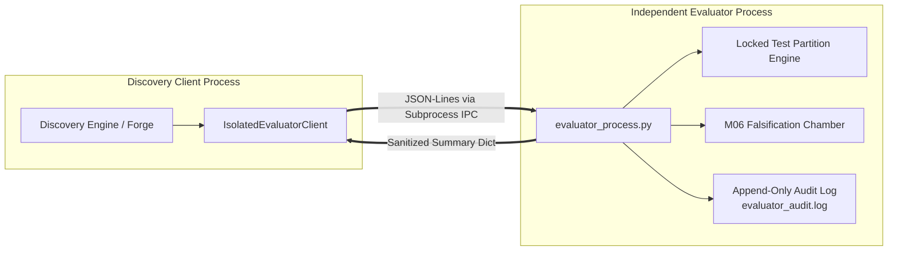

# SENSEFORGE: Independent Evaluator Isolation Architecture

**Project:** SENSEFORGE  
**Classification:** Experimental Computational Science / Artificial Intelligence Research  
**Version:** `0.3.1-alpha`  
**Status:** ARCHITECTURAL SPECIFICATION & THREAT MODEL  

---

## 1. Motivation for Process Separation

In computational discovery research, in-process isolation mechanisms (e.g. Python object encapsulation or access restrictions) are vulnerable to:
1. **Shared Heap Pointer Leakage:** Candidates accessing hidden attributes via `gc.get_objects()`, `object.__subclasses__()`, or memory inspection.
2. **State Pollution:** Mutation of global random number generators or module-level singletons.
3. **Covert Side Channels:** Measuring simulation execution time or garbage collection delays to deduce hidden parameter values.

To guarantee scientific independence, Phase 04.1 implements an **OS Process-Separated Evaluation Architecture**:

---

## 2. Process Boundary Protocol

The evaluation is managed across an operating-system process boundary:
1. **Candidate Serialization:** The discovery engine serializes the candidate payload to a locked temporary JSON file.
2. **Subprocess Spawning:** [`IsolatedEvaluatorClient`](file:///c:/akshar/senseforge/falsification/isolated_evaluator.py) launches `python -m senseforge.falsification.evaluator_process`.
3. **Configuration Verification:** The evaluator process recomputes and verifies the candidate's SHA-256 configuration hash.
4. **Seed Custody:** The evaluator process holds custody of the locked test partition seeds. The caller never observes the seed list or raw trajectory frames.
5. **Ground Truth Isolation:** Ground truth parameters are queried internally by the evaluator and used strictly for loss evaluation.
6. **Audit Logging:** An append-only log record (`evaluator_audit.log`) is written, recording timestamp, candidate ID, hash, and summary performance.
7. **Sanitized Response:** The evaluator outputs only statistical summary reports and the final epistemic state.

---

## 3. Host Threat Model & Security Considerations

### 3.1 What Process Separation Defends Against
- **Direct Memory Access:** Python child process memory space is isolated by the operating system kernel. The discovery process cannot inspect or modify variables in the evaluator process.
- **Reference Leakage:** Pointers to `BaseEnvironment` or latent parameters cannot cross the IPC boundary.
- **Accidental Retuning:** The evaluator checks the locked partition registry independently, aborting execution if retuning is attempted.

### 3.2 Security Limitations on Windows Hosts
- **Host Security Boundaries:** On Windows workstations, child processes spawned by standard users run under the same OS user identity. Process separation provides **architectural decoupling and epistemic isolation**, but not hardened OS-level multi-tenant sandboxing (such as Linux seccomp/cgroups or virtualization).
- **Windows Smart App Control (SAC):** As verified in Phase 01–04, Windows SAC actively restricts unsigned executables. The evaluation architecture strictly uses the standard Python runtime without attempting to disable or bypass host security controls.
