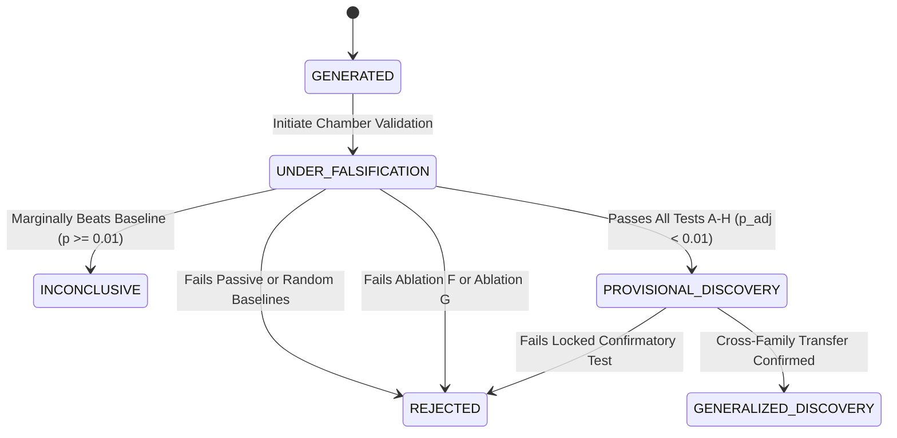

# SENSEFORGE: Falsification Chamber Specification (Module M06)

**Project:** SENSEFORGE  
**Classification:** Experimental Computational Science / Artificial Intelligence Research  
**Version:** `0.3.0-alpha`  
**Module:** M06 FALSIFICATION CHAMBER  
**Status:** FULLY IMPLEMENTED & VERIFIED  

---

## 1. System Mission & Theoretical Mandate

The **Falsification Chamber (M06)** is the adversarial verification engine of SENSEFORGE. Its purpose is **not** to celebrate evolutionary fitness scores, but to systematically attempt to **refute, invalidate, and falsify** candidate measurement instruments $\Psi = (\Phi, \Pi)$ produced by Module M05 (`DiscoveryForge`).

Automated evolutionary search engines are notoriously susceptible to:
1. **Search Overfitting (P-Hacking):** Exploiting random initial conditions or idiosyncratic seeds.
2. **Target Mismatch:** Claiming predictive gains by comparing the candidate against unperturbed passive states while evaluating on perturbed states.
3. **Operator Redundancy:** Evolving complex ASTs that mathematically collapse to near-identity functions (e.g. `Clip(Channel(0), [-2, 2])`).
4. **Data Processing Inequality Violations:** Claiming that passive mathematical transformations can magically generate new mutual information from restricted observation channels.

To eliminate these failure modes, Module M06 subjects candidate instruments to 10 rigorous, multi-tiered falsification tests (Tests A through J) executed on non-overlapping held-out validation and locked confirmatory partitions.

---

## 2. The 10 Falsification Tests (Tests A through J)

```
┌────────────────────────────────────────────────────────────────────────┐
│                      MODULE M06 FALSIFICATION TESTS                    │
├────────────────────────────────┬───────────────────────────────────────┤
│ Test Category                  │ Description                           │
├────────────────────────────────┼───────────────────────────────────────┤
│ Test A: Held-Out Multi-Seed    │ Generalization across unseen seeds     │
│ Test B: Parameter Invariance   │ Robustness to physics parameter shifts│
│ Test C: Passive Control (BL A) │ Zero-action physical control          │
│ Test D: Random Ensemble (BL C) │ K=5 matched random probe ensemble     │
│ Test E: Impulse Control (BL D) │ Heuristic single-pulse benchmark      │
│ Test F: Sham Intervention      │ Action applied to unmeasured channel  │
│ Test G: Temporal Null Surrog.  │ Circular shift / phase randomization  │
│ Test H: Component Ablations    │ Ablations F, G, and H3 dissection     │
│ Test I: Sensitivity Analysis   │ Sensitivity to observation horizon    │
│ Test J: Noise Stress Testing   │ AWGN & sensor failure degradation     │
└────────────────────────────────┴───────────────────────────────────────┘
```

### Test A: Held-Out Multi-Seed Generalization
- **Purpose:** Evaluates whether candidate performance replicates across unseen environment initialization seeds ($N \ge 30$).
- **Protocol:** Candidate configuration is cryptographically locked; evaluation is executed against the sealed confirmatory partition.
- **Pass Threshold:** Statistically significant outperformance ($\alpha = 0.01$) with positive Normalized Predictive Skill ($SS > 0.05$).

### Test B: Parameter Invariance & Shift
- **Purpose:** Tests whether the instrument relies on overfitted tuning of environment constants (e.g., oscillator natural frequencies or coupling constants).
- **Protocol:** Environment parameters are shifted by $\pm 25\%\text{--}50\%$ (e.g. coupling $k=1.5$, damping $\gamma=0.08$).
- **Rejection Criterion:** If prediction loss degrades by more than $5\times$ relative to baseline shifts, candidate is flagged for overfitting.

### Test C: Baseline A (Passive Observation Control)
- **Purpose:** Measures the exact value added by the physical probe $\Pi$ over purely passive observation.
- **Protocol:** Probe $\Pi$ is replaced with an equal-duration `WaitAction`. Both candidate and baseline forecast the exact same post-probe environment state.
- **Rejection Criterion:** Candidate must outperform Baseline A with $SS \ge 0.10$ and $p < 0.01$.

### Test D: Baseline C (Matched Random Probe Ensemble)
- **Purpose:** Disproves the hypothesis that *any* arbitrary disturbance reveals the latent state equally well.
- **Protocol:** Candidate probe is compared against an ensemble of $K = 5$ random intervention sequences matched in total duration, step count, and action magnitude ceiling.
- **Rejection Criterion:** Candidate must outperform the mean loss of the random ensemble with $SS \ge 0.05$ ($p < 0.01$).

### Test E: Baseline D (Standard Impulse Heuristic)
- **Purpose:** Compares the evolved probe against a standard engineering impulse probe (single Dirac-like excitation).
- **Protocol:** Single-step maximum bounded perturbation followed by observation relaxation.

### Test F: Sham Intervention Control
- **Purpose:** Evaluates whether the probe effect is specific to the observed dynamical system or merely injects arbitrary kinetic energy.
- **Protocol:** Intervention actions are redirected to an orthogonally decoupled channel or inactive degree of freedom.
- **Rejection Criterion:** If sham intervention achieves equal or higher predictive skill than the candidate, the probe's specific spatial structure is refuted.

### Test G: Temporal Null Surrogate Control
- **Purpose:** Verifies whether predictive skill arises from true dynamical coupling rather than static marginal distributions or autocorrelation artifacts.
- **Protocol:** Generates constrained temporal null surrogates (Theiler's algorithm):
  1. Circular time-shift ($t \mapsto (t + \tau) \pmod T$).
  2. Fourier phase-randomization preserving power spectral density.
- **Rejection Criterion:** Candidate must significantly outperform ($p < 0.01$) the surrogate null distribution.

### Test H: Full Component Ablation (Ablations F, G, H3)
- **Purpose:** Dissects the dual genome $\Psi = (\Phi, \Pi)$ to verify that **both** the measurement operator $\Phi$ and the experimental probe $\Pi$ are essential:
  - **Ablation F ($\text{Channel}(0) + \Pi$):** Raw observation channel coupled with evolved probe. If $\text{Loss}(\Psi) \approx \text{Loss}(\text{Ablation F})$, the mathematical operator $\Phi$ is redundant.
  - **Ablation G ($\Phi + \Pi_{\text{random}}$):** Evolved operator coupled with matched random probe. If $\text{Loss}(\Psi) \approx \text{Loss}(\text{Ablation G})$, the probe $\Pi$ is generic and not co-adapted.
  - **Ablation H3 ($\Phi + \text{Passive}$):** Evolved operator coupled with passive observation. Isolates pure observational feature extraction from physical probing.
- **Rejection Criterion:** If Candidate $\Psi$ fails to significantly outperform either Ablation F or Ablation G, the candidate is declared **non-synergistic** or **redundant**.

### Test I: Observation Horizon Sensitivity
- **Purpose:** Assesses sensitivity to observation window length $T_{\text{pre}}$ and forecast horizon $H$.

### Test J: Noise Stress & Sensor Failure Injection
- **Purpose:** Stress-tests instrument robustness against observational noise (Additive White Gaussian Noise, $\sigma \in [0.05, 0.50]$) and transient frame dropouts.
- **Measurement:** Degradation slope $\frac{\partial \text{MSE}}{\partial \sigma}$.

---

## 3. Epistemic Decision Architecture & State Machine



### Formal Epistemic States:
1. **`GENERATED`:** Evolved candidate created by Discovery Forge; untested.
2. **`UNDER_FALSIFICATION`:** Actively undergoing adversarial tests in M06.
3. **`REJECTED`:** Falsified by one or more baseline comparisons, ablations, or sealed tests.
4. **`INCONCLUSIVE`:** Shows positive skill but fails stringent statistical significance ($\alpha = 0.01$) or Holm-Bonferroni correction.
5. **`PROVISIONAL_DISCOVERY`:** Decisively outperforms Baselines A–D and Ablations F–G across locked held-out seeds with $p_{\text{adj}} < 0.01$.
6. **`GENERALIZED_DISCOVERY`:** Retains predictive skill across out-of-family environment transfers (M07).

