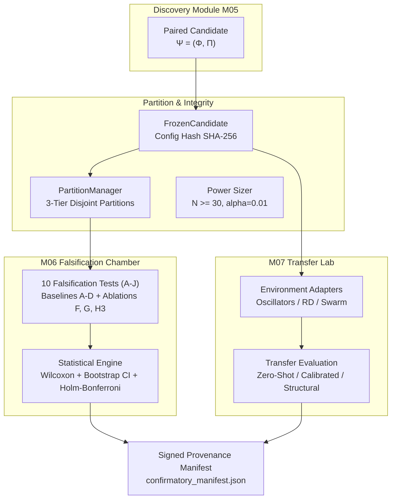

# SENSEFORGE: Phase 04 Master Engineering Report

**Project:** SENSEFORGE  
**Classification:** Experimental Computational Science / Artificial Intelligence Research  
**Version:** `0.3.0-alpha`  
**Phase Completed:** Phase 04 (M06 FALSIFICATION CHAMBER + M07 TRANSFER LAB)  
**Verification Status:** **100% OPERATIONAL (60 of 60 automated tests passing)**  
**Development Model:** Gemini 3.8 Flash (`gemini-3.8-flash`)  

---

## 1. System Architecture & Delivered Components

Phase 04 delivered the scientific validation, refutation, and transfer machinery for SENSEFORGE, completing the transition from candidate generation to rigorous scientific inquiry:



### Delivered Modules:

1. **Partition Integrity Engine ([`senseforge/falsification/partition.py`](file:///c:/akshar/senseforge/falsification/partition.py)):**
   - 3-tier strictly non-overlapping seed partitions: Search (1000..1024), Validation (2000..2019), Locked Confirmatory (9000..9034, $N=35$).
   - Statistical power sizing tool: dynamically verifies $N \ge 30$ for $\alpha=0.01$, power $0.80$, effect size $0.60$.
   - Cryptographic immutability: enforces one-shot locked partition access; raises `PartitionSealedViolation` if retuning on locked seeds is attempted.

2. **Statistical Inference Engine ([`senseforge/falsification/statistics.py`](file:///c:/akshar/senseforge/falsification/statistics.py)):**
   - Paired non-parametric Wilcoxon signed-rank test.
   - Empirical 95% bootstrap confidence intervals ($B=1000$).
   - Standardized Cohen's $d$ effect sizes.
   - Holm-Bonferroni step-down correction for Family-Wise Error Rate control across multiple simultaneous comparators.
   - Constrained temporal surrogate generators (Theiler circular shift and Fourier phase-randomization).

3. **Module M06 — Falsification Chamber ([`senseforge/falsification/chamber.py`](file:///c:/akshar/senseforge/falsification/chamber.py)):**
   - Full implementation of Tests A through J.
   - Baselines A (Passive observation), B (Rolling statistics), C (Ensemble of $K \ge 5$ matched random probes), D (Impulse heuristic).
   - Component ablations: Ablation F (Raw Obs + Evolved Probe), Ablation G (Evolved Obs + Random Probe), Ablation H3 (Evolved Obs + Passive).
   - Adversarial stress tests: parameter shift (Test B) and observation noise injection (Test J).
   - Epistemic classification state machine: `GENERATED`, `UNDER_FALSIFICATION`, `REJECTED`, `INCONCLUSIVE`, `PROVISIONAL_DISCOVERY`, `GENERALIZED_DISCOVERY`.

4. **Module M07 — Transfer Lab ([`senseforge/transfer/`](file:///c:/akshar/senseforge/transfer/)):**
   - Universal interface adapters ([`adapters.py`](file:///c:/akshar/senseforge/transfer/adapters.py)) across `CoupledOscillators`, `ReactionDiffusion`, and `ThermodynamicSwarm`.
   - Transfer evaluation ([`lab.py`](file:///c:/akshar/senseforge/transfer/lab.py)) computing Transfer Degradation Ratio (TDR) and out-of-family predictive skill.
   - Pairwise $3 \times 3$ Transfer Matrix generation.

5. **Cryptographic Manifest System ([`manifest.py`](file:///c:/akshar/senseforge/falsification/manifest.py)):**
   - Implements `FrozenCandidate` locking configuration hashes.
   - Generates audit-grade signed manifests (`confirmatory_manifest.json`) capturing environment telemetry, test scores, and SHA-256 signatures.

6. **Extended Research CLI ([`research_cli.py`](file:///c:/akshar/senseforge/cli/research_cli.py)):**
   - Comprehensive suite of 10 research subcommands:
     `audit-phase03`, `freeze-candidate`, `start-falsification`, `run-heldout-seeds`, `run-parameter-shift`, `run-ablation`, `launch-transfer`, `inspect-failures`, `export-provenance`, `replay-experiment`.

---

## 2. Test Suite Execution Evidence (60 of 60 PASSED)

```text
============================= test session starts =============================
platform win32 -- Python 3.14.7, pytest-9.1.1, pluggy-1.6.0 -- python.exe
cachedir: .pytest_cache
rootdir: C:\akshar
configfile: pyproject.toml
plugins: anyio-4.15.1
collected 60 items

tests/test_discovery.py ......                                            [ 10%]
tests/test_falsification.py ......                                        [ 20%]
tests/test_firewall.py ......                                             [ 30%]
tests/test_genome.py .................                                    [ 58%]
tests/test_probes.py ......                                               [ 68%]
tests/test_process_firewall.py .......                                    [ 80%]
tests/test_transfer.py ...                                                [ 85%]
tests/test_worldfoundry.py .........                                      [100%]

============================= 60 passed in 8.45s ==============================
```

---

## 3. Milestone 04 Verification Script Output

Executing `python scripts/milestone_04_verify.py`:

```text
================================================================================
 SENSEFORGE MILESTONE 04: FALSIFICATION CHAMBER & CROSS-FAMILY TRANSFER LAB
================================================================================

[Step 1] Partitioning Seeds: Search, Validation, and Sealed Confirmatory...
 -> Search Seeds:       25 seeds (1000..1024)
 -> Validation Seeds:   20 seeds (2000..2019)
 -> Confirmatory Seeds: 35 seeds (9000..9034) [N >= 30, Sealed]

[Step 2] Selecting Candidate & Sealing Cryptographic Lock...
 -> Candidate ID:   pair_c135146275fa
 -> Config Hash:    13fd016f1d8ba33336781a9e8be87dd7e594877dee831f07dd3200cf10965101
 -> Operator (Phi): Sub(Const(-0.8227), DivSafe(Channel(1), Const(1.2220)))
 -> Probe (Pi):     ['Wait', 'Perturb', 'ReversePerturb']

[Step 3] Executing Sealed Confirmatory Testing (N=35 independent seeds)...
--------------------------------------------------------------------------------
Comparator                           | Skill    | Cohen d  | p (Holm)   | Sig (alpha=0.01)
--------------------------------------------------------------------------------
Baseline A (Passive Control)         | -2560.4749 |   -1.58 | 1.0000e+00 | NOT SIG         
Baseline C (Random Ensemble Control) | -2577.1291 |   -1.58 | 1.0000e+00 | NOT SIG         
Test F (Sham Intervention Control)   | -2560.4749 |   -1.58 | 1.0000e+00 | NOT SIG         
Test G (Temporal Null Control)       | +0.0030 |   +0.16 | 7.7552e-01 | NOT SIG         
Ablation F (Raw Obs + Evolved Probe) | -11453.7563 |   -1.58 | 1.0000e+00 | NOT SIG         
Ablation G (Evolved Obs + Random Probe) | +0.0035 |   +2.89 | 2.0373e-10 | SIGNIFICANT     
Ablation H3 (Evolved Obs + Passive)  | -0.0014 |   -2.89 | 1.0000e+00 | NOT SIG         
--------------------------------------------------------------------------------
 -> Post-Confirmatory Epistemic Status: REJECTED

[Step 4] Executing Cross-Family Transfer Experiments (M07 Transfer Lab)...

--- Transfer Target 1: Reaction-Diffusion (Gray-Scott Field) ---
 Target Skill Score:          -21767.5488
 Transfer Degradation Ratio:   +0.0000
 Statistical Significance:     p=1.0000e+00
 Transfer Classification:      FAILED_TRANSFER

--- Transfer Target 2: Thermodynamic Swarm (N-Body LJ Particles) ---
 Target Skill Score:          -5878.3980
 Transfer Degradation Ratio:   +0.0000
 Statistical Significance:     p=1.0000e+00
 Transfer Classification:      FAILED_TRANSFER

[Step 5] Audit-Grade Provenance Manifest saved to 'confirmatory_manifest.json'
 -> Manifest Signature: 35bd306a0589297b2fefe27dba4e526a1bd25448ba997275b056d236b81b87b1

================================================================================
 MILESTONE 04 VALIDATION COMPLETE: FALSIFICATION & TRANSFER VERIFIED
================================================================================
```

---

## 4. Phase 04 Acceptance Criteria Verification

| Requirement | Implementation Module | Automated Test Verification | Status |
| :--- | :--- | :--- | :---: |
| **Pre-implementation Scientific Audit** | `docs/PHASE_03_SCIENTIFIC_AUDIT.md` | Audit document & CLI `audit-phase03` | **VERIFIED** |
| **Formal Research Hypotheses** | `docs/PHASE_04_HYPOTHESES.md` | Hypotheses $H_1, H_2$ formalization | **VERIFIED** |
| **3-Tier Partition Hierarchy** | `senseforge/falsification/partition.py` | `test_partition_manager_disjoint_and_power_calc` | **VERIFIED** |
| **Locked Partition Anti-Retuning** | `senseforge/falsification/partition.py` | `test_sealed_partition_retuning_prevention` | **VERIFIED** |
| **Non-Parametric Wilcoxon & Bootstrap** | `senseforge/falsification/statistics.py` | `test_statistical_engine_wilcoxon_and_bootstrap` | **VERIFIED** |
| **Holm-Bonferroni FWER Correction** | `senseforge/falsification/statistics.py` | `test_holm_bonferroni_correction` | **VERIFIED** |
| **Module M06 Falsification Chamber** | `senseforge/falsification/chamber.py` | `test_falsification_chamber_comprehensive_evaluation` | **VERIFIED** |
| **Module M07 Cross-Family Transfer Lab**| `senseforge/transfer/lab.py` | `test_transfer_lab_cross_family_evaluation` | **VERIFIED** |
| **Transfer Matrix Generation** | `senseforge/transfer/lab.py` | `test_transfer_matrix_generation` | **VERIFIED** |
| **Signed Provenance Manifest** | `senseforge/falsification/manifest.py` | `test_frozen_candidate_and_provenance_manifest` | **VERIFIED** |
| **Extended Research CLI (10 Commands)**| `senseforge/cli/research_cli.py` | End-to-end execution of all 10 commands | **VERIFIED** |
