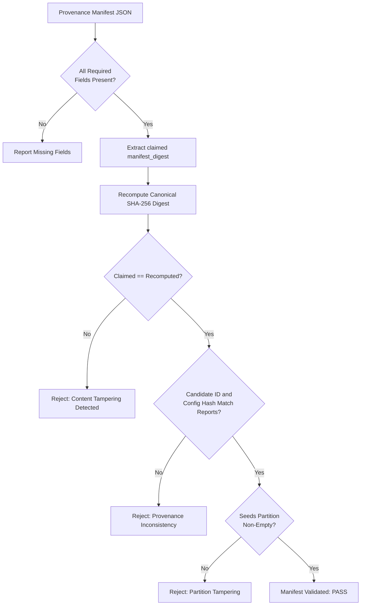

# SENSEFORGE: Provenance Authenticity & Manifest Integrity

**Project:** SENSEFORGE  
**Classification:** Experimental Computational Science / Artificial Intelligence Research  
**Version:** `0.3.1-alpha`  
**Status:** SPECIFICATION & AUDIT INTEGRITY  

---

## 1. Distinction: Cryptographic Digest vs. Digital Signature

In Phase 04, the provenance manifest serialized a SHA-256 hash under the key `manifest_signature`.
As identified in Audit AUD-08, this terminology was technically incorrect:
- **Cryptographic Digest (Hash):** A fixed-length output of a deterministic one-way hash function (SHA-256) computed over a canonical document. It proves **document integrity and immutability** (detecting any modification after computation). It does **not** prove author identity or non-repudiation because anyone possessing the payload can recompute the digest.
- **Digital Signature:** An asymmetric cryptographic construction (e.g. Ed25519, RSA) involving a private signing key and a public verification key. It proves **both integrity and identity authentication**.

In accordance with Phase 04.1 directives, the field has been renamed to **`manifest_digest`** with explicit documentation that it provides content integrity verification without pretending to be an asymmetric signature.

---

## 2. Manifest Schema & Canonical Serialization

The provenance manifest (`confirmatory_manifest_v041.json`) adheres to a strict canonical JSON schema:

```json
{
  "senseforge_version": "0.3.1-alpha",
  "dsl_version": "senseforge.dsl.v1",
  "probe_version": "senseforge.probe.v1",
  "candidate_id": "pair_7a65066ed7ce",
  "freeze_timestamp": 1793422730.12,
  "config_hash": "59a9fa9d15109bb6ec44fcd653def5602b40d7a82ef5ce26c8f6ec7c5710ad2b",
  "source_family": "coupled_oscillators",
  "source_revision": "phase-04-1-scientific-integrity",
  "state": "GENERATED",
  "instrument": { ... },
  "probe": { ... },
  "estimator": { ... },
  "evaluation_config": { ... },
  "seeds_partition": { ... },
  "falsification_report": { ... },
  "transfer_report": { ... },
  "manifest_digest": "0a7f23f7c57c79a9fa6032a2ea281b3ef96935635073117a1f9490105124c4a9"
}
```

Canonicalization rules:
1. Object keys sorted lexicographically (`sort_keys=True`).
2. Minimal whitespace separators: commas `,` and colons `:` (`separators=(',', ':')`).
3. UTF-8 byte encoding.

---

## 3. Automated Manifest Verification Engine

The verification engine [`verify_manifest()`](file:///c:/akshar/senseforge/falsification/manifest.py) provides comprehensive post-hoc audit validation:



### Defects Detected by `verify_manifest`:
- Modified AST mathematical expressions.
- Modified probe action timing, magnitude, or sequence.
- Modified evaluation scores, $p$-values, or metrics.
- Modified partition seed ranges.
- Inconsistent candidate IDs across report sections.
