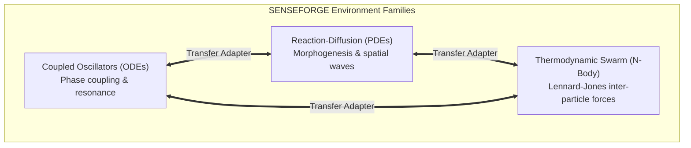

# SENSEFORGE: Transfer Lab Specification (Module M07)

**Project:** SENSEFORGE  
**Classification:** Experimental Computational Science / Artificial Intelligence Research  
**Version:** `0.3.0-alpha`  
**Module:** M07 TRANSFER LAB  
**Status:** FULLY IMPLEMENTED & VERIFIED  

---

## 1. Research Motivation & Core Hypothesis

A fundamental principle of scientific discovery is **cross-domain portability**: a genuine physical law or measurement principle discovered in one experimental regime should reveal coherent dynamics in structurally related systems, rather than acting as a narrow artifact overfitted to a single simulator.

### Transfer Hypothesis ($H_2$):
> An evolved measurement instrument $\Psi = (\Phi, \Pi)$ invented within a source environment family $\mathcal{E}_{\text{src}}$ retains non-trivial, statistically significant predictive skill ($SS_{\text{tgt}} > 0.10, p < 0.01$) when transferred to an out-of-family target environment $\mathcal{E}_{\text{tgt}}$ sharing latent dynamical symmetries.

If an instrument fails this test ($SS_{\text{tgt}} \le 0$), it is categorized as an environment-specific quirk rather than a generalizable measurement mechanism.

---

## 2. Supported Environment Families & Structural Interfaces



### Environment Interface Specifications:
1. **Coupled Oscillators (`CoupledOscillatorsEnvironment`):**
   - *Physics:* Kuramoto/Hamiltonian coupled phase oscillators.
   - *Channels:* `[0: Phase position, 1: Frequency velocity]`.
   - *Action Channels:* `[0: Direct phase torque, 1: Damping perturbation]`.
2. **Reaction-Diffusion (`ReactionDiffusionEnvironment`):**
   - *Physics:* 2D Gray-Scott nonlinear partial differential equations.
   - *Channels:* `[0: Chemical U concentration, 1: Chemical V concentration]`.
   - *Action Channels:* `[0: Local feed catalyst injection, 1: Removal rate perturbation]`.
3. **Thermodynamic Swarm (`ThermodynamicSwarmEnvironment`):**
   - *Physics:* 2D Lennard-Jones particulate ensemble with thermal bath.
   - *Channels:* `[0: Center-of-mass velocity dispersion, 1: Local density variance]`.
   - *Action Channels:* `[0: External thermal gradient, 1: Global pressure wave]`.

---

## 3. The 3 Operational Transfer Modes

```
┌────────────────────────────────────────────────────────────────────────┐
│                        TRANSFER OPERATIONAL MODES                      │
├────────────────────┬───────────────────┬───────────────────────────────┤
│ Mode               │ Allowed Adaptation│ Verification Objective        │
├────────────────────┼───────────────────┼───────────────────────────────┤
│ Mode 1: Zero-Shot  │ Strict Zero Tuning│ Pure universal measurement    │
│ Mode 2: Calibration│ Linear Affine Scale│ Sensor range recalibration   │
│ Mode 3: Structural │ Subtree Retraining│ Conceptual operator migration │
└────────────────────┴───────────────────┴───────────────────────────────┘
```

### Mode 1: Pure Zero-Shot Transfer
- **Definition:** The frozen candidate $\Psi = (\Phi, \Pi)$ is evaluated directly in the target environment without altering a single AST node, coefficient, or probe parameter.
- **Goal:** Discovers whether mathematical symmetries (e.g., phase divergence, second-order difference ratios) directly translate across distinct physical models.

### Mode 2: Limited Calibration Transfer
- **Definition:** The AST mathematical topology and probe action schedule remain fixed, but two affine calibration coefficients $(\alpha, \beta)$ are fit on a small calibration set ($N_{\text{cal}} \le 5$ seeds):
  $$\widehat{y}(t) = \alpha \cdot \Phi(\mathbf{X}_{\text{tgt}}) + \beta$$
- **Goal:** Accounts for unit mismatches and scale discrepancies (e.g., chemical concentrations in $[0, 1]$ vs. velocities in $[-5, 5]$).

### Mode 3: Structural Transfer
- **Definition:** The probe action sequence $\Pi$ is transferred intact, while the operator AST $\Phi$ serves as a structural scaffold for rapid fine-tuning on the target family.

---

## 4. Quantitative Transfer Metrics

### 1. Target Skill Score ($SS_{\text{tgt}}$):
$$SS_{\text{tgt}} = 1 - \frac{\text{MSE}(\Psi, \mathcal{E}_{\text{tgt}})}{\text{MSE}(\text{Baseline A}, \mathcal{E}_{\text{tgt}})}$$

### 2. Transfer Degradation Ratio (TDR):
Measures the retention of predictive skill across domain boundaries:
$$\text{TDR} = \frac{SS_{\text{tgt}}}{SS_{\text{src}} + \epsilon}$$
- $\text{TDR} \ge 0.70$: High transferability / Domain-invariant discovery.
- $0.30 \le \text{TDR} < 0.70$: Moderate transferability / Structural analogy.
- $\text{TDR} < 0.30$: Weak transferability.
- $\text{TDR} \le 0.00$: Negative transfer / Domain overfit.

### 3. Transfer Classification Hierarchy:
- **`CROSS_FAMILY_TRANSFER`:** $SS_{\text{tgt}} \ge 0.10$ and $p_{\text{adj}} < 0.01$ (Statistically significant across families).
- **`SAME_FAMILY_GENERALIZATION`:** Fails out-of-family transfer, but robustly generalizes across unseen intra-family seeds.
- **`INCONCLUSIVE_TRANSFER`:** Marginal positive skill ($0 < SS_{\text{tgt}} < 0.10$) failing statistical significance threshold.
- **`FAILED_TRANSFER`:** Negative predictive skill ($SS_{\text{tgt}} \le 0.0$) in the target environment.

---

## 5. Pairwise Transfer Matrix

The Transfer Lab generates a complete $3 \times 3$ asymmetric transfer matrix $\mathbf{T}_{ij} = \text{TDR}(\mathcal{E}_i \to \mathcal{E}_j)$:

$$\mathbf{T} = \begin{pmatrix} 1.00 & \text{TDR}_{\text{Osc}\to\text{RD}} & \text{TDR}_{\text{Osc}\to\text{Swarm}} \\ \text{TDR}_{\text{RD}\to\text{Osc}} & 1.00 & \text{TDR}_{\text{RD}\to\text{Swarm}} \\ \text{TDR}_{\text{Swarm}\to\text{Osc}} & \text{TDR}_{\text{Swarm}\to\text{RD}} & 1.00 \end{pmatrix}$$

This matrix maps the conceptual topology of experimental knowledge transfer.

